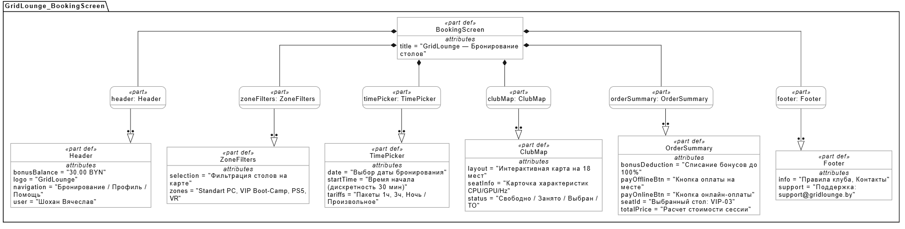
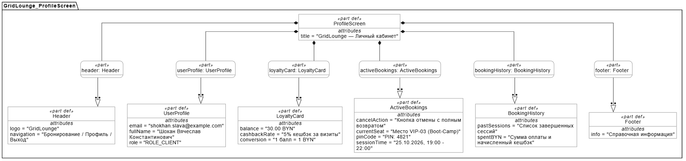
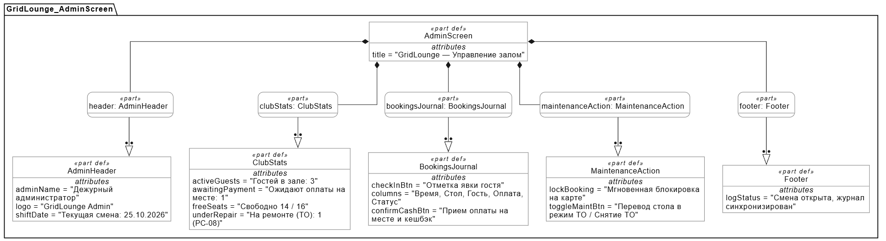
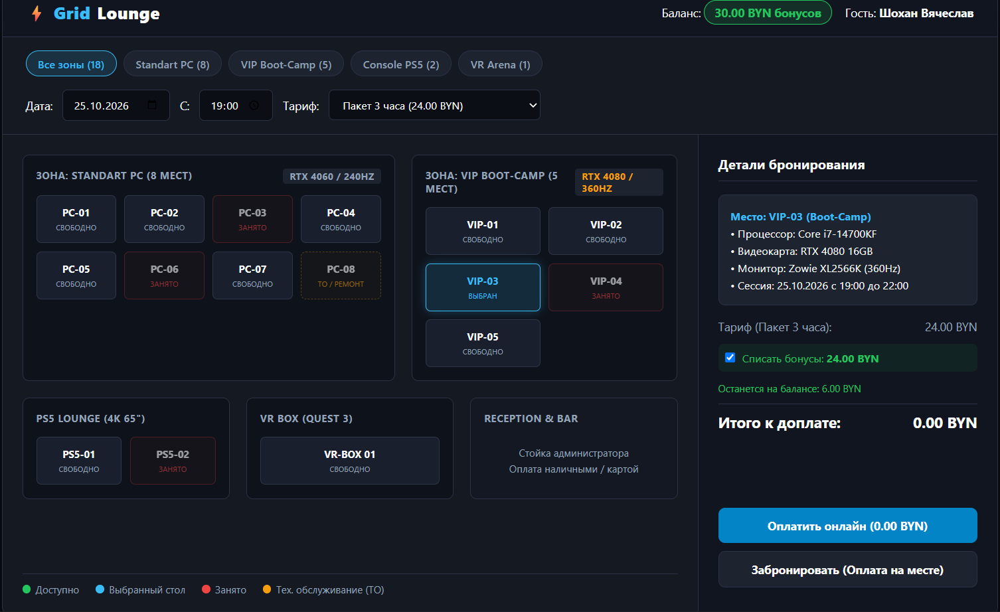
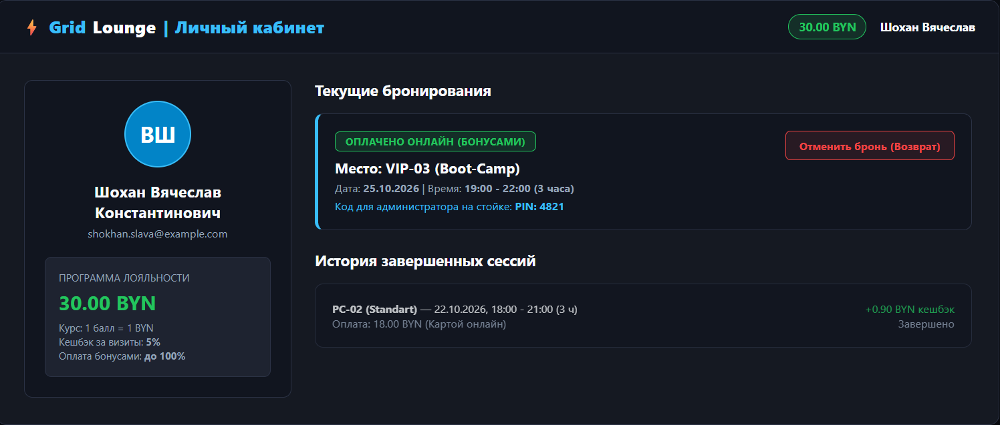
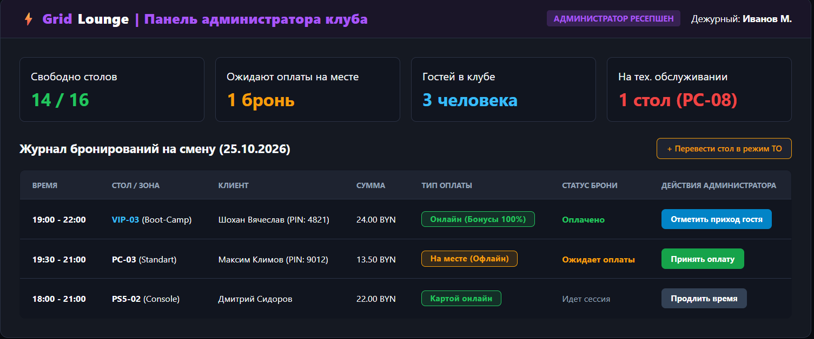

# Спецификация требований к ПО

Для GridLounge

Версия 0.1

Подготовил Шохан Вячеслав Константинович

БГУИР

25 октября 2026 г.

## Оглавление

* [1. Введение](#introduction)
  * [1.1 Назначение документа](#document-purpose)
  * [1.2 Область применения продукта](#product-scope)
  * [1.3 Определения, акронимы и сокращения](#definitions)
  * [1.4 Ссылки](#references)
  * [1.5 Обзор документа](#document-overview)
* [2. Обзор продукта](#product-overview)
  * [2.1 Перспектива продукта](#product-perspective)
  * [2.2 Функции продукта](#product-functions)
  * [2.3 Ограничения продукта](#product-constraints)
  * [2.4 Характеристики пользователей](#user-characteristics)
  * [2.5 Допущения и зависимости](#assumptions)
  * [2.6 Распределение требований](#apportioning)
* [3. Требования](#requirements)
  * [3.1 Внешние интерфейсы](#external-interfaces)
  * [3.2 Функциональные требования](#functional)
  * [3.3 Качество обслуживания](#quality)
  * [3.4 Соответствие стандартам](#compliance)
  * [3.5 Проектирование и реализация](#implementation)
  * [3.6 ИИ/МО](#aiml)
* [4. Верификация](#verification)
* [5. Приложения](#appendixes)

## История изменений

| Name | Date | Reason For Changes | Version |
|------|------|--------------------|---------|
| Шохан Вячеслав Константинович | 25.10.2026 | Первоначальная разработка спецификации требований для GridLounge | 0.1 |

---

## 1. Введение

### 1.1 Назначение документа

Настоящий документ (SRS) определяет требования к веб-приложению бронирования столов в компьютерном клубе GridLounge. Документ предназначен для заказчика (администрации клуба), менеджера проекта, разработчиков и специалистов по тестированию. SRS определяет, что должна делать система, и служит нормативной основой для проектирования, кодирования, тестирования и сдачи лабораторных работ по дисциплине ЖЦРПО.

### 1.2 Область применения продукта

GridLounge — клиент-серверное веб-приложение для дистанционного бронирования игровых мест, выбора оборудования (Standart PC, VIP Boot-Camp, консоли PlayStation 5, VR-зона), проведения онлайн- или офлайн-оплаты, накопления бонусных баллов и оперативного контроля посадки гостей администратором.

Бизнес-цели продукта:

- **BR-1:** Устранить риск овербукинга (двойного бронирования) посадочных мест за счет централизованного учета временных интервалов.
- **BR-2:** Упростить выбор стола для гостей клуба через наглядную интерактивную карту с отображением технических характеристик железа.
- **BR-3:** Повысить конверсию бронирований за счет гибких сценариев оплаты (онлайн картой либо наличными на месте за стойкой ресепшен).
- **BR-4:** Стимулировать повторные визиты гостей с помощью накопительной программы лояльности (кешбэк 5%, оплата бонусами до 100%).
- **BR-5:** Снизить нагрузку на персонал стойки регистрации при посадке гостей и техническом менеджменте зала.

В первую версию (MVP) входят 18 посадочных мест клуба, каталог пакетных и поминутных тарифов, расчет стоимости, списание бонусов, почтовые уведомления, личный кабинет с отменой сессии и панель управления администратора. Интеграция с шеллом блокировки клиентских ПК (SmartShell/Gizmo) и управление питанием через сетевые розетки не входят в область проекта.

### 1.3 Определения, акронимы и сокращения

| Term | Definition |
|------|------------|
| API | Application Programming Interface — интерфейс взаимодействия клиента и сервера |
| BR | Business Requirement — высокоуровневая бизнес-цель |
| BYN | Белорусский рубль, расчетная валюта клуба |
| JWT | JSON Web Token — защищенный токен авторизации веб-запросов |
| MVP | Minimum Viable Product — минимально жизнеспособный продукт |
| SRS | Software Requirements Specification — спецификация требований к ПО |
| Овербукинг | Ошибочная ситуация параллельного оформления брони на один и тот же стол на пересекающееся время |
| Слот | Минимальный интервал времени бронирования (шаг 30 минут) |
| Кешбэк | Возврат 5% от оплаченной суммы заказа на бонусный счет гостя (1 балл = 1 BYN) |
| ТО | Режим технического обслуживания стола (вывод из эксплуатации на ремонт) |

### 1.4 Ссылки

1. Учебный шаблон SRS из репозитория курса ЖЦРПО.
2. Методические указания к лабораторной работе №3 «Разработка и документирование бизнес-требований».
3. СТП 01-2017 «Общие требования к оформлению текстовых студенческих работ» — Минск: БГУИР, 2017.
4. [OMG SysML v2 Specification](https://www.omg.org/spec/SysML/2.0/) — стандарт языка моделирования требований и GUI-прототипов.

### 1.5 Обзор документа

Раздел 2 описывает архитектурный контекст продукта, функции, профили пользователей и ограничения. Раздел 3 содержит структурированные функциональные и качественные требования. Раздел 4 задает сквозную матрицу верификации. Раздел 5 включает структурные модели SysML v2 и визуальные мокапы экранов.

---

## 2. Обзор продукта

### 2.1 Перспектива продукта

GridLounge является автономной веб-платформой автоматизации компьютерного клуба. Сервис объединяет клиентский интерфейс самообслуживания гостей и служебный интерфейс администратора ресепшен. Система разворачивается по клиент-серверной модели: фронтенд выполняется в браузере пользователя, бэкенд обрабатывает запросы и хранит состояние в центральной базе данных клуба.

Предпочтительный технологический стек: Java 21, Spring Boot 3 для backend; PostgreSQL 15 для хранения данных; React 18 для пользовательского интерфейса.

### 2.2 Функции продукта

- Регистрация и авторизация гостей по email с выдачей JWT-токена.
- Просмотр интерактивной карты залов клуба с цветовой индикацией занятости в реальном времени.
- Выбор посадочного места категорий Standart PC, VIP Boot-Camp, Console PS5 и VR Arena.
- Выбор фиксированных пакетов («1 час», «3 часа», «Ночь») или произвольного интервала времени.
- Расчет стоимости сессии с возможностью списания бонусов до 100%.
- Проведение оплаты онлайн через шлюз эквайринга либо бронирование с оплатой наличными на месте.
- Начисление кешбэка на бонусный баланс гостя (1 балл = 1 BYN).
- Отмена активной брони в личном кабинете до наступления времени начала с полным возвратом средств.
- Отправка электронных писем с подтверждением, PIN-кодом заказа и деталями сессии.
- Панель администратора: контроль занятости, отметка прихода гостя, прием оплаты на месте и вывод мест на ТО.

### 2.3 Ограничения продукта

- Интерфейс приложения должен быть полностью русскоязычным и адаптивным к мобильным и десктопным экранам.
- Все расчеты производятся в белорусских рублях (BYN) с точностью до копеек.
- Оплата онлайн на этапе MVP имитируется тестовым шлюзом с формированием статуса `PAID`.
- Отмена бронирования гостем возможна исключительно до наступления забронированного часа.
- Максимальный размер списания бонусов равен стоимости заказа (доплата от 0.00 BYN).

### 2.4 Характеристики пользователей

- **Клиент (Гость клуба):** пользователь с базовыми навыками работы с браузером. Ожидает наглядного выбора железа по карте, моментального подтверждения брони и удобного контроля бонусов.
- **Администратор клуба:** сотрудник за стойкой ресепшен. Ожидает оперативный журнал броней на смену, возможность в один клик принять наличные и заблокировать сломанный ПК.

### 2.5 Допущения и зависимости

- Гость указывает актуальный email-адрес, к которому имеет оперативный доступ.
- Временная недоступность внешнего SMTP-сервера не должна препятствовать сохранению брони в БД.
- Терминал администратора имеет постоянное локальное подключение к серверу клуба.

### 2.6 Распределение требований

В версию 0.1 (MVP) входят: карта залов, выбор тарифов, защита от овербукинга, баланс бонусов, сценарии онлайн/офлайн оплаты, отмена брони и дашборд администратора. В перспективные версии (0.2+) выносятся: интеграция с Telegram-ботом, привязка клубного лаунчера ПК и сканирование QR-кодов на стойке.

---

## 3. Требования

### 3.1 Внешние интерфейсы

#### 3.1.1 Пользовательские интерфейсы

Интерфейс должен быть выполнен в современной темной теме киберспортивной стилистики. Основные экраны:

- **BookingScreen:** фильтры категорий столов, выбор даты и тарифа, интерактивная карта зала с подсветкой столов (зеленый — свободно, красный — занято, голубой — выбран, оранжевый — ТО), карточка характеристик ПК и панель расчета с оплатой бонусами.
- **ProfileScreen:** карточка гостя, баланс бонусов, активные бронирования с PIN-кодом и кнопкой возврата, история завершенных визитов.
- **AdminScreen:** сводка загрузки клуба, таблица журнала смены с поиском, кнопки подтверждения оплаты на месте и модальное окно перевода места в режим ремонта (ТО).

#### 3.1.2 Аппаратные интерфейсы

Специализированное оборудование не требуется. Взаимодействие происходит через стандартный сетевой стек TCP/IP и периферию ввода (мышь, клавиатура, сенсорный экран).

#### 3.1.3 Программные интерфейсы

- Интеграция с СУБД PostgreSQL через пул соединений JDBC (Spring Data JPA).
- Программный шлюз отправки email-сообщений по протоколу SMTP/SMTPS.
- REST API для обмена данными между React SPA и Spring Boot в формате JSON.

### 3.2 Функциональные требования

**REQ-FUNC-001: Аутентификация и профиль пользователя**

- **Statement:** Система должна обеспечивать регистрацию пользователей по email, надежное хранение хешированных паролей (BCrypt) и авторизацию с выдачей JWT-токена. В профиле отображается персональный баланс бонусов.
- **Rationale:** Идентификация клиентов для учета броней и ведения накопительного счета (BR-4).
- **Verification Method:** Test.

**REQ-FUNC-002: Интерактивный выбор места по карте клуба**

- **Statement:** Система должна передавать векторную структуру зала и актуальный статус доступности 18 посадочных мест (Standart PC, VIP Boot-Camp, PS5, VR). По клику на доступный стол открывается карточка характеристик оборудования (CPU, GPU, монитор). Занятые места и столы на ТО не могут быть выбраны.
- **Rationale:** Наглядность выбора железа гостем (BR-2).
- **Verification Method:** Demonstration.

**REQ-FUNC-003: Гибкий выбор времени и тарифов**

- **Statement:** Система должна предоставлять выбор фиксированных пакетов («1 час», «3 часа», «Ночь») либо произвольного времени с шагом в 30 минут. Выбор времени в прошлом блокируется.
- **Rationale:** Удовлетворение разных сценариев посещения клуба (BR-2).
- **Verification Method:** Test.

**REQ-FUNC-004: Исключение овербукинга**

- **Statement:** Система должна выполнять транзакционную проверку доступности выбранного слота в БД с блокировкой строки (`SELECT ... FOR UPDATE`). При одновременной попытке бронирования одного стола успехом завершается только первая транзакция; второму клиенту возвращается ошибка HTTP 409 Conflict.
- **Rationale:** Гарантия отсутствия двойных посадок (BR-1).
- **Verification Method:** Test.

**REQ-FUNC-005: Вариативная оплата и расчет бонусов**

- **Statement:** Система должна рассчитывать стоимость сессии и позволять списать до 100% стоимости бонусными баллами (1 бонус = 1 BYN). Клиент выбирает «Оплату онлайн» (списание средств сразу) либо «Оплату на месте» (фиксация брони в статусе ожидания оплаты администратором).
- **Rationale:** Гибкость расчетов и повышение конверсии (BR-3, BR-4).
- **Verification Method:** Demonstration, Test.

**REQ-FUNC-006: Программа лояльности (начисление кешбэка)**

- **Statement:** Система должна начислять 5% кешбэка на бонусный счет гостя. При оплате онлайн бонусы зачисляются в момент наступления времени сессии. При оплате на месте — в момент подтверждения приема оплаты администратором.
- **Rationale:** Стимулирование повторных визитов гостей (BR-4).
- **Verification Method:** Test.

**REQ-FUNC-007: Отмена бронирования и возврат средств**

- **Statement:** Клиент должен иметь возможность отменить бронь в личном кабинете в любое время до наступления часа ее начала. При отмене предоплаченной брони денежные средства и списанные бонусы полностью возвращаются, а стол мгновенно становится свободным.
- **Rationale:** Справедливая политика обслуживания клиентов (BR-3).
- **Verification Method:** Test.

**REQ-FUNC-008: Оповещение по электронной почте**

- **Statement:** Система должна отправлять HTML-письмо на подтвержденный email гостя при создании брони (с указанием места, времени и PIN-кода), ее отмене и зачислении кешбэка.
- **Rationale:** Сохранение подтверждающей квитанции у клиента (BR-2).
- **Verification Method:** Inspection.

**REQ-FUNC-009: Панель администратора клуба**

- **Statement:** Система должна предоставлять администратору журнала броней смены, возможность подтверждения оплаты на месте, отметку фактической посадки гостя и перевод стола в статус «ТО» с немедленной блокировкой на карте.
- **Rationale:** Оперативное управление залом и технический менеджмент (BR-5).
- **Verification Method:** Demonstration.

### 3.3 Качество обслуживания

#### 3.3.1 Производительность

- **REQ-PERF-001:** Время отклика API загрузки карты зала `/api/club/map` не должно превышать 200 мс (в 95-м перцентиле) при нагрузке до 50 одновременных пользователей.
- **REQ-PERF-002:** Фиксация транзакции бронирования в СУБД должна занимать не более 500 мс (p95).

#### 3.3.2 Безопасность

- **REQ-SEC-001:** Все внешние сетевые соединения должны быть защищены протоколом TLS 1.3 (HTTPS).
- **REQ-SEC-002:** Пароли пользователей должны хешироваться алгоритмом BCrypt (фактор 12). Сессия пользователя автоматически истекает после 30 минут бездействия.

#### 3.3.3 Надёжность

- **REQ-REL-001:** Время восстановления сервиса после сбоя (MTTR) не должно превышать 15 минут. Незавершенные онлайн-бронирования автоматически аннулируются шедулером через 15 минут, освобождая стол.

#### 3.3.4 Доступность

- **REQ-AVAIL-001:** Сервис должен обеспечивать доступность не менее 99.5% времени в режиме 24/7 для обеспечения круглосуточного бронирования.

#### 3.3.5 Наблюдаемость

- **REQ-OBS-001:** Все входящие HTTP-запросы должны содержать уникальный Correlation ID. Финансовые транзакции и действия администратора логируются в структурированном виде и хранятся не менее 90 дней.

### 3.4 Соответствие стандартам

Оформление проектной документации выполняется по СТП 01-2017 БГУИР. Обработка персональных данных (email, ФИО) соответствует Закону Республики Беларусь от 7 мая 2021 г. № 99-З «О защите персональных данных».

### 3.5 Проектирование и реализация

#### 3.5.1 Установка

Компоненты системы (бэкенд, фронтенд, база данных) поставляются в виде готовых Docker-контейнеров с запуском командой `docker compose up -d`.

#### 3.5.2 Сборка и поставка

Серверная часть собирается с помощью Maven в единый исполняемый JAR. Версионирование ведется в Git с обсуждением требований через Pull Requests.

#### 3.5.4 Сопровождаемость

Кодовая база строится по принципам Clean Architecture с четким разделением контроллеров, сервисов и репозиториев. Покрытие бизнес-логики тестами должно составлять не менее 70%.

### 3.6 ИИ/МО

Не применяется для текущей версии MVP. Процессы резервирования ресурсов клуба и финансовые транзакции базируются на строгой детерминированной логике и не требуют вероятностных нейросетевых моделей.

---

## 4. Верификация

| Requirement ID | Verification Method | Сценарий проверки | Status | Evidence |
|----------------|---------------------|-------------------|--------|----------|
| REQ-FUNC-001 | Test | Проверить регистрацию, вход, хеширование пароля BCrypt и генерацию JWT | Planned | `AuthServiceTest.java` |
| REQ-FUNC-002 | Demonstration | Открыть карту зала, проверить отображение 18 мест, фильтрацию зон и карточку VIP-03 | Passed | Скриншот мокапа бронирования |
| REQ-FUNC-003 | Test | Проверить выбор тарифов 1ч/3ч/Ночь, произвольное время и блокировку прошлых дат | Planned | `TimeSlotCalculatorTest.java` |
| REQ-FUNC-004 | Test | Сымитировать 2 параллельных запроса на бронь стола PC-01 на 19:00: первая успевает, вторая получает 409 Conflict | Planned | `BookingConcurrencyTest.java` |
| REQ-FUNC-005 | Demonstration, Test | Проверить расчет 24 BYN, списание 24 бонусов (к доплате 0.00 BYN) и выбор оплаты на месте | Planned | Скриншот оформления заказа |
| REQ-FUNC-006 | Test | Проверить начисление 5% кешбэка при старте онлайн-сессии и по кнопке администратора | Planned | `LoyaltyServiceTest.java` |
| REQ-FUNC-007 | Test | Нажать «Отменить бронь» до начала сессии: проверить возврат 24 бонусов и освобождение стола | Planned | `CancellationTest.java` |
| REQ-FUNC-008 | Inspection | Проверить генерацию HTML-квитанции бронирования с PIN-кодом и адресом клуба | Planned | Почтовые логи GreenMail |
| REQ-FUNC-009 | Demonstration | В панели администратора принять оплату за PC-03 и перевести PC-08 в режим ТО | Passed | Скриншот панели администратора |
| REQ-PERF-001–002 | Test | Нагрузочные тесты k6: время отдачи карты ≤ 200мс, фиксация бронирования ≤ 500мс (p95) | Planned | Отчет k6 |
| REQ-SEC-001–002 | Inspection, Test | Проверить протокол TLS 1.3, отсутствие паролей в открытом виде и сброс сессии через 30 мин | Planned | Аудит SecurityConfig |
| REQ-REL-001, REQ-AVAIL-001 | Test | Проверить аннулирование неоплаченной брони через 15 мин и отчет Uptime 99.5% | Planned | Отчет шедулера очистки |
| REQ-OBS-001 | Inspection | Проверить наличие Correlation ID в цепочке логов от контроллера до запроса в СУБД | Planned | Лог `application.log` |

---

## 5. Приложения

Графическая часть включает структурные модели компонентов пользовательского интерфейса, разработанные на языке SysML v2, и визуальные мокапы экранов системы.

### Структурные модели компонентов интерфейса (SysML v2)

*Рисунок 1 — Структурный прототип страницы бронирования на SysML v2. [Исходник SysML v2](diagrams/booking-page.sysml).*

*Рисунок 2 — Структурный прототип личного кабинета на SysML v2. [Исходник SysML v2](diagrams/profile-page.sysml).*

*Рисунок 3 — Структурный прототип панели администратора на SysML v2. [Исходник SysML v2](diagrams/admin-page.sysml).*

### Визуальные мокапы интерфейса

Следующие изображения иллюстрируют компоновку интерфейса и внешний вид основных экранов веб-приложения GridLounge (автор прототипа: Шохан Вячеслав Константинович):

*Рисунок 4 — Мокап страницы бронирования с интерактивной картой залов, фильтрами и списанием бонусов.*

*Рисунок 5 — Мокап личного кабинета гостя с балансом бонусов, активной бронью (PIN: 4821) и кнопкой отмены.*

*Рисунок 6 — Мокап панели управления администратора с журналом смены, приемом оплаты на месте и управлением ТО.*

---
Требования версии 0.1 согласованы в рамках ролевой игры «Заказчик — Менеджер». Все доработки и замечания стейкхолдеров фиксируются в репозитории проекта через Pull Request с обоснованием принятых решений. Отчет оформлен в соответствии с требованиями действующего СТП БГУИР.